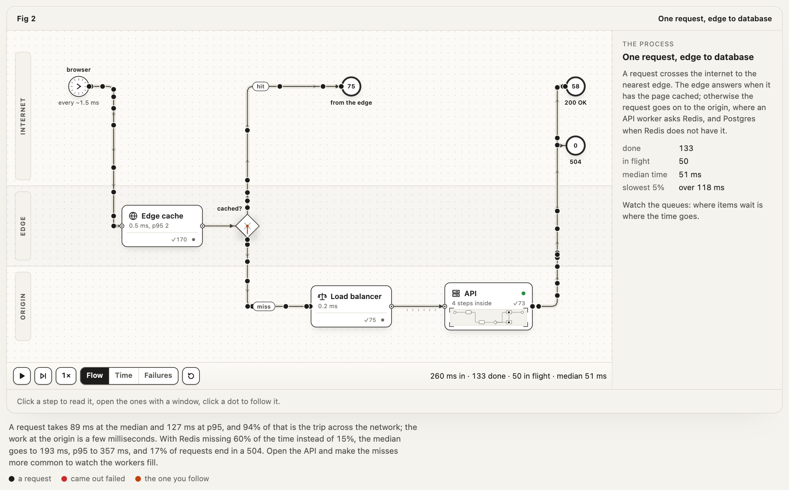
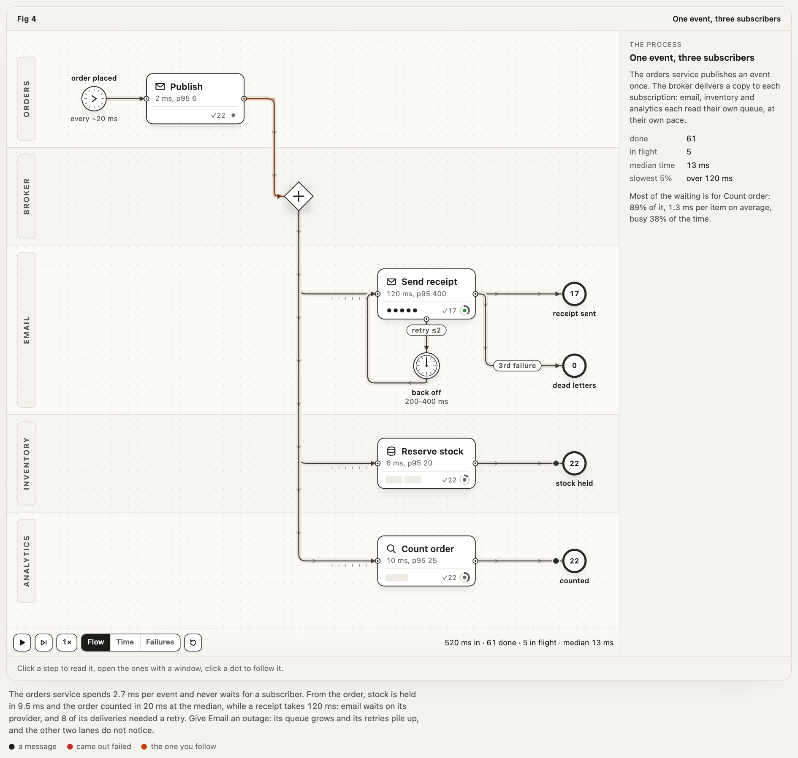
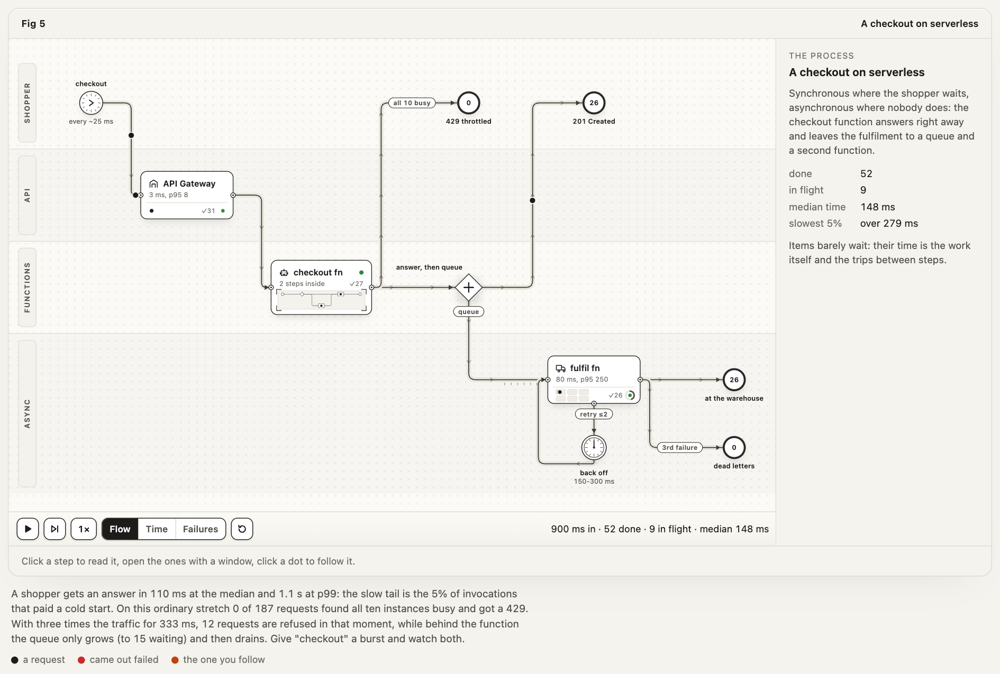
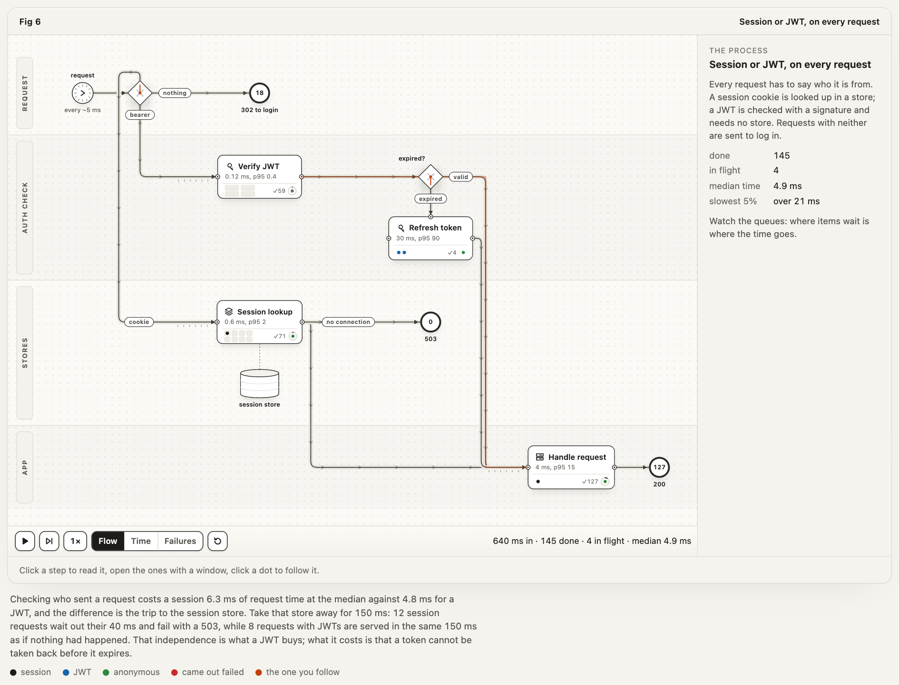
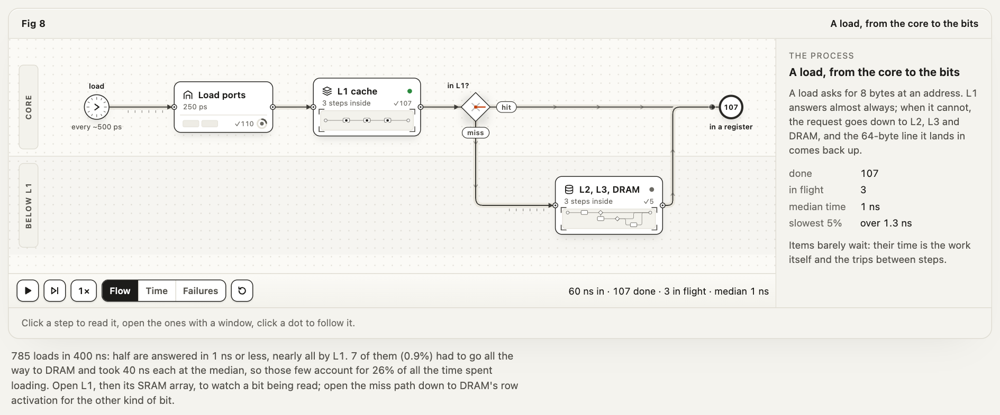
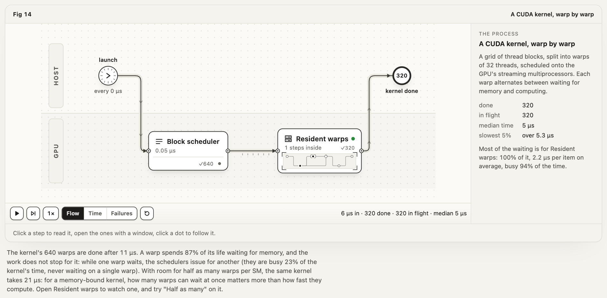
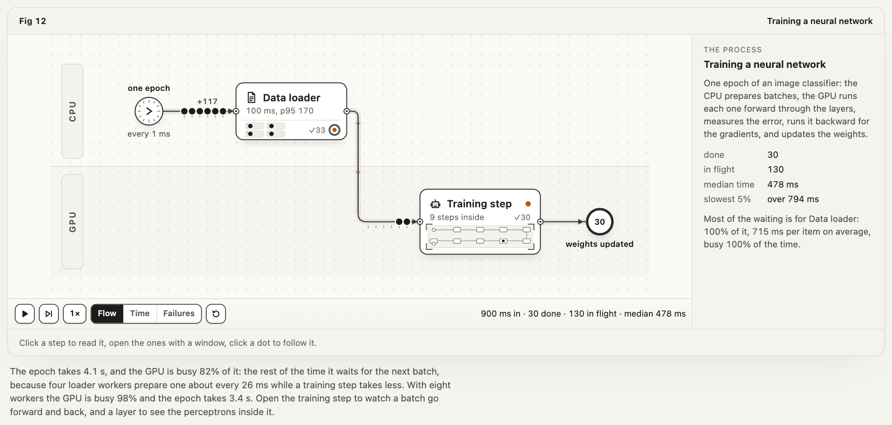
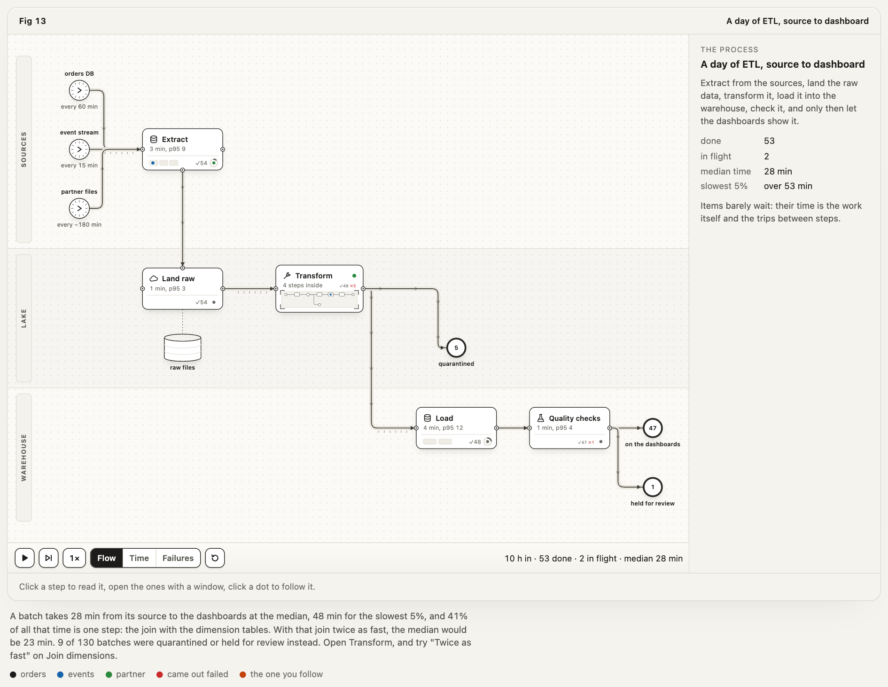

<h1 align="center">Dissect</h1>

<p align="center"><b>Explain a process by running it.</b></p>

<p align="center">
  <a href="#install">Install</a> ·
  <a href="#use">Use</a> ·
  <a href="#gallery">Gallery</a> ·
  <a href="#how-it-works">How it works</a> ·
  <a href="#the-model">The model</a> ·
  <a href="#checks">Checks</a>
</p>

Dissect is an [Agent Skill](https://agentskills.io) for Claude Code (it also runs in Codex, OpenCode and Antigravity). Describe a process (a CI/CD pipeline, a request through your architecture, a network protocol, an LLM and its tools, a cipher's rounds, a memory access, an on-call rotation) and it builds an interactive figure of it: a floor plan of stations, queues, gates and lanes, driven by a seeded discrete-event simulation. A queue on screen is a queue in the model, and every number in the caption is measured from the run the figure plays. Any step that hides a process of its own opens into it, any item can be followed from start to end, and the reader can try what-ifs (an outage, one more reviewer, a colder cache) and watch what they do.

<p align="center">
  <picture>
    <source media="(prefers-color-scheme: dark)" srcset="assets/ci-pipeline-dark.png">
    
  </picture>
</p>

## Install

Dissect is one skill folder, `skills/dissect`, with a `SKILL.md` at its root. Pick one way in:

| | Command | Installs to |
|---|---|---|
| **Claude Code plugin** | `/plugin marketplace add destbreso/dissect`, then `/plugin install dissect@dissect` | managed by Claude Code |
| **skills CLI**, for you | `npx skills add destbreso/dissect -g -a claude-code` | `~/.claude/skills/dissect` |
| **skills CLI**, one project | `npx skills add destbreso/dissect -a claude-code` | `.claude/skills/dissect` |
| **skills CLI**, other agents | `-a codex`, `-a opencode` or `-a antigravity` instead of `-a claude-code` | that agent's skills folder |
| **Download** | see below | any skills folder |

<details>
<summary>Download without git or npm</summary>

```sh
mkdir -p ~/.claude/skills/dissect && curl -L https://github.com/destbreso/dissect/archive/refs/heads/main.tar.gz | tar -xz --strip-components=3 -C ~/.claude/skills/dissect dissect-main/skills/dissect
```

For a project, use `.claude/skills/dissect` instead. For Codex use `~/.agents/skills/dissect`, for OpenCode `~/.config/opencode/skills/dissect`, for Antigravity `~/.gemini/antigravity/skills/dissect`.

</details>

There is nothing else to install: the kit uses only Node's built-in modules. The browser checks need Chrome or Chromium.

## Use

Ask for what you want to explain. The skill triggers on processes, pipelines, workflows, architectures, flows and protocols, whether or not you say "diagram" or "simulation":

> Our PRs take forever to merge and everyone blames CI. Make an interactive figure of our pipeline for the wiki: about 30 PRs a day, CI takes 8 minutes, two of us review, and one PR in five gets changes requested.

> Explain how TCP retransmission works with something visual and interactive.

> Show how memory works, from flip-flops up to the cache hierarchy and RAM, for a computer architecture class.

The agent writes a model of the process with real or stated numbers, calibrates it on several runs, writes the caption from the run, builds a standalone HTML page (or a fragment for a page you have, or a React component), audits it, and checks it in a headless browser. With `/dissect` (or `/dissect:dissect` from the plugin) you can call it by name.

## Gallery

Every example is a model in `skills/dissect/examples/<name>/model.mjs` and a page built from it next to it. Open the pages in a browser; each one runs, opens and answers what-ifs. Rebuild one with `node skills/dissect/examples/<name>/build.mjs` (`--light`, `--dark`, `--audit`).

| | |
|---|---|
| <a href="skills/dissect/examples/ci-pipeline/ci-pipeline.html"></a><br>**From commit to production.** CI and Ship open into their own processes; red builds and requested changes go back to the author. A third of a change's time is waiting for the one reviewer on duty. | <a href="skills/dissect/examples/request-path/request-path.html"></a><br>**One request, edge to database.** Requests travel with real latencies. The trip is almost all of the time, and a colder cache fills the API's workers until 504s start. |
| <a href="skills/dissect/examples/tcp-ip/tcp-ip.html"></a><br>**One segment through TCP/IP.** Down the sender's layers, through a router whose buffer overflows, up the receiver's. A loss costs a round trip, or a whole retransmission timer. | <a href="skills/dissect/examples/pubsub/pubsub.html"></a><br>**One event, three subscribers.** A fan-out to email, inventory and analytics, each with its own queue, retries and dead letters. Take one down and the others do not notice. |
| <a href="skills/dissect/examples/serverless/serverless.html"></a><br>**A checkout on serverless.** Concurrency limits and cold starts on the synchronous path, a queue on the asynchronous one. A burst is refused by one and absorbed by the other. | <a href="skills/dissect/examples/auth-flows/auth-flows.html"></a><br>**Sessions, JWTs and OAuth.** The check on every request, with a session store outage as the what-if, and an OAuth login with PKCE in three phases you can open. |
| <a href="skills/dissect/examples/llm-harness/llm-harness.html"></a><br>**A message to an LLM, and its harness.** The model stays a closed box; the context, the tool loop and the output check are the figure. Every tool call is another full turn through the model. | <a href="skills/dissect/examples/aes/aes.html"></a><br>**AES, from the mode to the S-box.** CBC and CTR with GCM encrypt the same message side by side; open AES for its rounds, a round for its steps, SubBytes for the S-box. |
| <a href="skills/dissect/examples/memory/memory.html"></a><br>**A load, from the core to the bits.** Five levels deep: L1 down to its SRAM array and output flip-flop, the miss path down to DRAM's row activation, where a bit is a capacitor. | <a href="skills/dissect/examples/cuda/cuda.html"></a><br>**A CUDA kernel, warp by warp.** 640 warps alternate between waiting for memory and computing. Halve the warps that can wait at once and the kernel takes twice as long. |
| <a href="skills/dissect/examples/neural-network/neural-network.html"></a><br>**Training a neural network.** A data loader feeds the GPU; the forward pass runs one way and the backward pass the other; a layer is 128 perceptrons. The GPU waits for data. | <a href="skills/dissect/examples/etl/etl.html"></a><br>**A day of ETL, source to dashboard.** Three sources at their own rhythm, through extract, land, transform, load and checks. One step, the join, is most of the time to the dashboard. |
| <a href="skills/dissect/examples/incident-response/incident-response.html"></a><br>**An alert, from page to resolved.** One on-call engineer, escalation after 15 minutes, a war room. Four alerts in five are noise, and real problems wait behind them. |  |

## How it works

1. **A model.** One JavaScript object: lanes, parts (starts, stations with servers and work times, choices, parallel splits and joins, timers, stores, ends), routes with odds or outcomes and latencies, and the claims the prose makes about the numbers. Durations are written the way people know them: `"logn 12 30"` is a median of 12 and a p95 of 30.
2. **A simulation.** A discrete-event simulator runs the model with one seed and one random stream per part, so a run is reproducible and a what-if changes only what comes after it. It was checked against queueing theory (M/M/1 and Little's law).
3. **A floor plan.** Columns sized to their parts, a router that picks every orthogonal route by cost (never through a part or over words), and a drawing in which each detail stands for a quantity: one bay per server, one tick per place in the queue, a gauge for the busy share, a needle for the last decision.
4. **A page.** A standalone HTML file with the runtime inlined (no network, no build step): the page replays the simulator's log, so the drawing moves only as the model does. Levels open with a zoom, the clock slows to each level's own scale, items can be followed, and the what-ifs re-run the model from the moment you press them.
5. **Checks.** An audit of the model, the floor plan, the run and the claims on eight seeds; a visual check that measures the drawing in headless Chrome on every level, in both themes and in a wide font, on a desktop and a phone (words inside their plates and clear of rails, contrast, sideways scroll, a short drive); captures and scripted drives.

`skills/dissect/SKILL.md` is the workflow the agent follows; `skills/dissect/references/` has the notation, the craft, the kit's API, the page's behavior, the checks and a walkthrough.

## The model

```js
export default {
  id: "review-loop", title: "A change through review", item: "change", unit: "min", seed: 1, horizon: 480,
  lanes: [{ id: "dev", label: "Author" }, { id: "review", label: "Review" }],
  parts: [
    { id: "push", kind: "start", lane: "dev", at: [0, 0], every: "exp 20" },
    { id: "review", kind: "station", lane: "review", at: [1, 0], label: "Code review", servers: 1, work: "logn 12 30", fail: 0.15, failLabel: "changes requested" },
    { id: "fix", kind: "station", lane: "dev", at: [1, 0], label: "Fix it", servers: "inf", work: "logn 15 45" },
    { id: "merged", kind: "end", lane: "review", at: [2, 0] },
  ],
  routes: [
    { from: "push", to: "review" },
    { from: "review", to: "merged", when: "ok", label: "approved" },
    { from: "review", to: "fix", when: "fail", label: "changes" },
    { from: "fix", to: "review" },
  ],
  claims: [{ metric: "review.waitShare", min: 0.2, say: "much of a change's time is waiting for review" }],
};
```

```sh
node skills/dissect/scripts/build.mjs review-loop.mjs --audit    # writes review-loop.html next to it
```

## Checks

```sh
npm test                                                               # the kit and every example's audit
node skills/dissect/examples/ci-pipeline/build.mjs --audit --check     # ends with "audit passed" and "check passed"
node skills/dissect/scripts/capture.mjs page.html --width 390 --out phone.png
node skills/dissect/scripts/drive.mjs page.html --actions steps.json   # clicks, keys, what-ifs, asserts
```

## Requirements

| | For | Notes |
|---|---|---|
| Node.js 20.10+ | builds, kit, checks | Built-in modules only. On Node 20 the browser scripts restart themselves with `--experimental-websocket`. |
| Chrome or Chromium | the browser checks | Found in the usual places on macOS, Linux and Windows and in Playwright's cache; set `CHROME_PATH` for any other. |
| React 18+ | React output only | See `skills/dissect/references/kit.md`. |

## Credits

Dissect takes its idea from [Anatomy](https://github.com/wheresryan22/anatomy), which explains a technical idea as a crafted isometric machine whose working is the concept. Dissect applies that to processes: the machine is the process itself, and it runs.

## License

[MIT](LICENSE) © 2026 David Estévez
